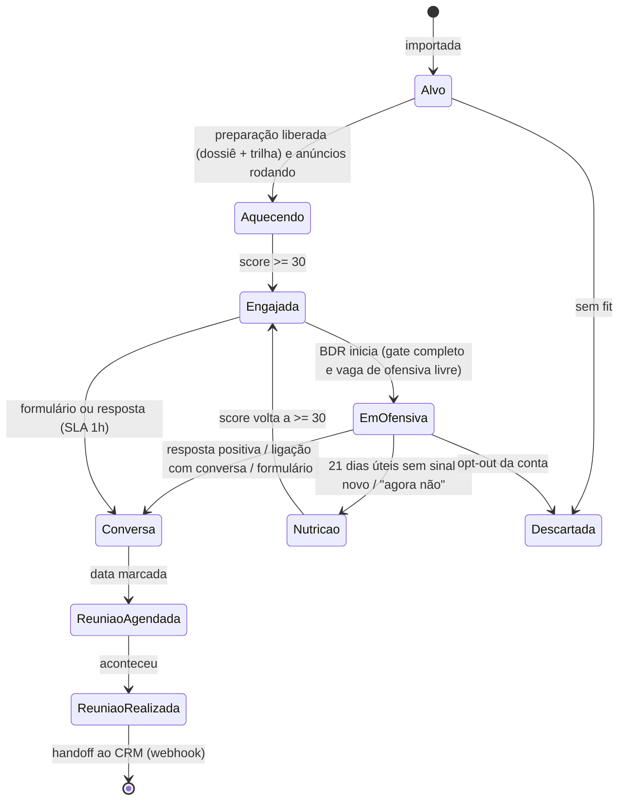
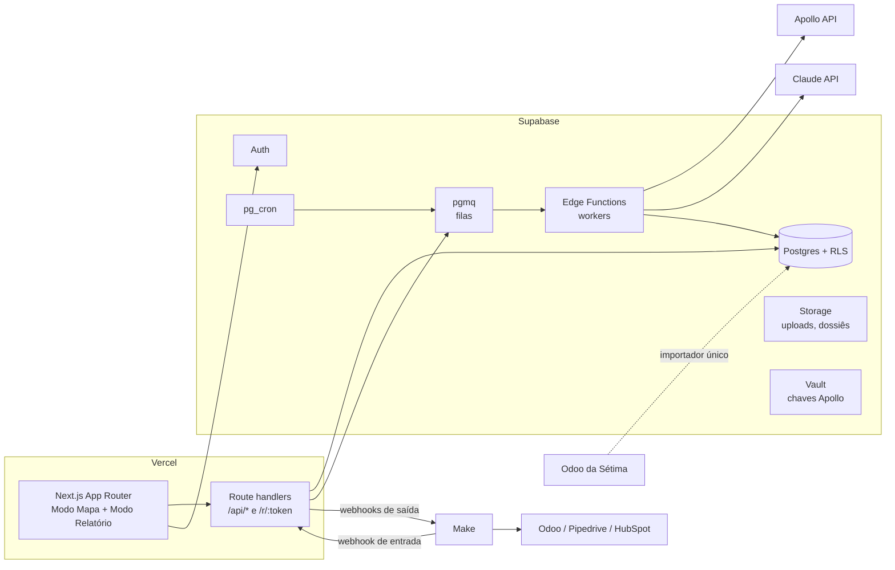

# PRD — Indaba MVP

> **Produto:** Indaba — plataforma de ABM para vendas B2B complexas, com a operação do BDR em formato de jogo
> **Metodologia:** nome próprio ainda não definido (variável `NEXT_PUBLIC_METHOD_NAME`)
> **Versão:** 2.0 · 28/out/2026 · Dono: Diego Rodrigues (Vivaz)
> **Leitores:** Claude Code (implementação), Diego (produto), e a próxima etapa de design system (seção 14)
> **Substitui:** `PRD-cerco-v1.md` (21/out). O que mudou: a camada de jogo virou o centro da UX, o Apollo entra por API já no MVP, e a referência funcional passa a ser a operação real da Sétima no Odoo (seção 1).

**Regra de nomes:** nada fixo no código. Use `NEXT_PUBLIC_APP_NAME` ("Indaba") e `NEXT_PUBLIC_METHOD_NAME` em toda a interface, e-mails e prompts.

---

## Sumário

1. Ponto de partida: a operação ABM Sétima no Odoo
2. Decisões já tomadas
3. Posicionamento (contexto para produto e conteúdo)
4. Usuários e papéis
5. O jogo: como a metodologia vira mecânica
6. Escopo do MVP
7. Arquitetura de informação e telas
8. Requisitos funcionais
9. Sinais, score, estágios e cerco
10. Modelo de dados
11. Arquitetura técnica e ADRs
12. Integrações (MVP e depois)
13. Agentes de IA
14. Direção de UI/UX (insumo para o design system)
15. Métricas do piloto
16. Marcos de construção
17. Riscos
18. Perguntas em aberto
19. Instruções para o Claude Code
20. Fontes

---

## 1. Ponto de partida: a operação ABM Sétima no Odoo

O MVP não parte do zero. A metodologia já roda na Sétima (configurador 3D / content-tech) dentro do Odoo, montada pelo Diego e operada por uma SDR. Esta seção registra **o que existe hoje** para que o Indaba tenha paridade funcional antes de ter diferenciação.

### 1.1 O que a operação faz hoje

| Elemento | Como está no Odoo hoje |
|---|---|
| Unidade de trabalho | A **conta** (oportunidade num pipeline "ABM Sétima"), ligada à empresa. Nada de lead solto. |
| Pipeline | Alvo → Aquecendo → Engajada → Em cadência → Conversa → Reunião agendada → Reunião realizada → Ganho/Perdido. Fora do fluxo: Nutrição e Descartada. |
| Card da conta (kanban) | Nome, domínio, tier (T1/T2/T3), temperatura (Fria/Engajada/Quente) com barra de score, status de preparação (na fila / liberada), trilha (ex.: sem configurador, configurador fraco), contadores (pessoas no comitê, decisores, conectados no LinkedIn, e-mails ok), próxima atividade, dias no estágio, SDR. |
| Ficha da conta | Blocos Conta (tier, trilha, preparação, SDR, último sinal), Cadência (status, sem sinal desde, próxima atividade, o que fazer) e Empresa (nomes no LinkedIn, site). Abas: Comitê de compra, Sinais, Dossiê/asset/links, Negócio. |
| Comitê de compra | Tabela por prioridade (1 decisor, 2 influenciador, 3 demais, fora do ICP), com cargo, papel, área, e-mail + status (verificado / extrapolado / indisponível), telefone, WhatsApp, LinkedIn, conexão, cadência on/off e opt-out. |
| Sinais | Registro próprio com data, tipo, contato, origem, pontos, ativo e detalhe. **Cada sinal soma pontos por 30 dias. 30+ = Engajada, 60+ = Quente.** |
| Motor | Anúncios no LinkedIn sobre o comitê. O relatório de engajamento por empresa entra a cada ~1 semana e vira um sinal com teto de 30 pontos (nível LinkedIn + interações + exposição por pessoa do comitê + views de vídeo). Só o snapshot mais recente fica ativo. |
| Gates | "Iniciar cadência" tem checklist de entrada: dossiê anexado, ficha da conta preenchida, trilha definida (não pode ficar "a definir"). |
| Cadência | 30–40 dias úteis, 1 SDR, e-mail + telefone + LinkedIn + WhatsApp. Gera **só atividades**; nada é enviado automaticamente. |
| Dossiê | Skill "Dossiê de Guerrilha" gera um dossiê por conta (pesquisa web + Apollo para contexto da conta). |
| Comitê | Inserido via Claude Code integrando o Apollo, com papel decisor/influenciador. |
| Dashboard | "Dashboard estratégico" com Resumo, Sinais, Jornada das contas, Onde agir, Execução e Visão por conta; leitura do período gerada por regras; export em PDF. |

### 1.2 Retrato atual (dashboard, 29/09 a 28/10/2026)

Serve de **linha de base** do piloto:

- 59 contas no programa; 41 com algum sinal (69%).
- 111 sinais captados, **99% vindos de LinkedIn Ads**.
- 1 resposta; **0 braço erguido** (resposta positiva).
- 126 atividades concluídas, **49% no prazo**; 4 atrasadas.
- Score médio 8 de 90; 57 frias, 2 engajadas, 0 quentes; **0 contas em cadência ativa**.
- Alertas que o próprio dashboard levanta: engajadas sem cadência ativa, 12 contas sem sinal há 21+ dias.

### 1.3 O que isso ensina para o produto

1. **O método funciona como estrutura, mas a operação trava na passagem para o 1:1.** Duas contas engajadas e nenhuma em cadência. O produto precisa tornar óbvio "o que fazer agora" quando a janela abre.
2. **O score depende de uma fonte só.** Quase todo ponto vem de ads. O produto tem que facilitar o registro de sinais 1:1 (conexão aceita, reação, resposta, clique no link pessoal), senão o "mapa" fica escuro mesmo com o BDR trabalhando.
3. **Atividade ≠ progresso.** 126 atividades concluídas e 1 resposta. A camada de jogo **não pode** premiar volume de atividade (ver 5.4).
4. **A informação existe, mas está espalhada em abas e tabelas.** Esse é o espaço de diferenciação de UX: mostrar a conta como um mapa onde se vê, de uma vez, quem está coberto, quem viu, quem reagiu e qual é a próxima jogada.

---

## 2. Decisões já tomadas

Herdadas das conversas anteriores e confirmadas aqui:

| # | Decisão |
|---|---|
| D1 | **Foco em ABM**, não CRM amplo. ICP: qualquer venda B2B com **3+ pessoas decidindo** (consultorias, serviços de tecnologia, audiovisual/content-tech, engenharia, indústria). O jogo só faz sentido porque existe um comitê para cercar. |
| D2 | **Camada sobre o CRM, não substituto.** O cliente mantém Odoo/Pipedrive/HubSpot para negócios. O Indaba opera a fase de prospecção até a reunião realizada e devolve a oportunidade ao CRM. |
| D3 | **Cadência gera tarefas, nunca envia.** O BDR envia pelos próprios canais; o Indaba registra o resultado. |
| D4 | **Ads entram por upload de relatório no MVP.** Sem API direta de LinkedIn/Meta. Públicos saem por CSV. |
| D5 | **Apollo por API no MVP** (novo nesta versão), para empresa, comitê e sinais de timing, com controle de créditos. |
| D6 | **Setup feito pela Vivaz.** Sem onboarding self-service. Área ADM para clientes, workspaces, acessos e (no futuro) cobrança. |
| D7 | **Piloto só com design partners**, sem cobrança: Sétima e Brandspot (mesma empresa, dois programas). |
| D8 | **SaaS por baixo, jogo por cima.** Modo Mapa (BDR, escuro) e Modo Relatório (gestor/board, claro). Linguagem de jogo implícita: "visão", "rotas", "objetivos", "cerco". Nenhuma marca de terceiros (ex.: LoL) no produto. |
| D9 | Stack: Next.js na Vercel, Supabase, GitHub, Claude API, Apollo API; construção com Claude Code. |

---

## 3. Posicionamento (contexto para produto e conteúdo)

> Estrutura da skill `campaign-plan`, condensada para servir de contexto ao produto. O plano de lançamento completo fica para depois do piloto.

### 3.1 Uma frase
**O Indaba mostra a conta-alvo como um mapa: quem decide, quem já viu sua marca e qual é a próxima jogada, para o BDR chegar no decisor sem spam.**

### 3.2 Categoria e mecanismo
- **Categoria (âncora):** plataforma de ABM. Não é CRM, não é ferramenta de gamificação, não é "AI SDR".
- **Mecanismo:** venda guiada por sinais sobre o comitê de compra.
- **Diferencial de experiência:** a operação vira um jogo de mapa (visão, rotas, objetivos), o que dá adesão ao BDR e clareza ao gestor.
- **Comparador de preço:** custa menos que uma agência e não exige contratar ninguém.

### 3.3 Para quem
| Papel | Quem é | O que quer | Objeção típica |
|---|---|---|---|
| **Comprador** | Diretor comercial/marketing ou founder de empresa B2B com ticket médio/alto e comitê | Reuniões com decisores de contas grandes, previsibilidade | "Já temos CRM e Apollo." "Isso é joguinho?" |
| **Usuário** | BDR/SDR (20–35 anos) | Saber o que fazer hoje, não escrever do zero, ver progresso | "Mais uma ferramenta para preencher." |
| **Patrocinador** | Vivaz (setup e acompanhamento) | Entregar o método com consistência em vários clientes | Tempo de setup por cliente |

### 3.4 Hierarquia de mensagem
1. **Por que importar:** em venda complexa, quem decide nunca é uma pessoa só, e o outbound em volume queima as contas que você mais quer.
2. **O que é:** um mapa da conta com o comitê, a visão que os anúncios geram e as missões do dia.
3. **Por que o Indaba:** o método vem pronto (tiers, comitê, sinais, cadência), a IA prepara dossiê e rascunhos, e o BDR joga uma partida por conta, não uma lista de tarefas.
4. **O que fazer:** "Raio-x do cerco": mapeamos uma conta-alvo sua ao vivo em 20 minutos.

**Regra de ouro da comunicação:** liderar pelo resultado (reunião com decisor, comitê coberto) e usar o jogo como lente. "Prospecção gamificada" na frente vira curiosidade; "chegue no decisor sem spam" vira desejo.

### 3.5 Concorrência que importa para o produto
| Alternativa | O que faz | Onde o Indaba é diferente |
|---|---|---|
| ZenABM | Analytics de ABM focado em LinkedIn Ads, a partir de US$ 59–69/mês; mostra engajamento por empresa e empurra para o CRM | O Indaba opera a conta (comitê, missões, cadência), não só mede. Em português, com setup. |
| Factors.ai, Dreamdata, Fibbler, Channel99, Octane11 | Atribuição B2B; são parceiros certificados da Company Intelligence API do LinkedIn | Foco em atribuição para marketing. O Indaba é a mesa de trabalho do BDR. |
| Spinify, SalesScreen | Gamificação de vendas por ranking, metas e competições | Premiam atividade e ranking individual. O Indaba premia estado da conta (ver 5.4). |
| 6sense, Demandbase | ABM enterprise com intenção de compra | Preço e complexidade fora do alcance do ICP brasileiro. |
| Apollo | Dados + sequências | É fonte de dados do Indaba, não concorrente direto. |
| Planilha + CRM | O jeito atual | É contra isso que o produto compete de verdade. |

### 3.6 Canais de aquisição (contexto)
Founder-led no LinkedIn (3 posts/semana, carrossel do mapa como ativo visual), replay de conta em vídeo a cada 15 dias, e o "Raio-x do cerco" como conversão. Isso afeta o produto em um ponto: **o Modo Mapa precisa ser bonito o bastante para ser printado** (seção 14).

---

## 4. Usuários e papéis

| Papel | Pode | Tela principal |
|---|---|---|
| `bdr` | Operar contas atribuídas: missões, comitê, sinais manuais, rascunhos | Missões do dia + Mapa da conta |
| `gestor` | Tudo do BDR em todas as contas do workspace; configurar programa; ver relatório | Relatório |
| `viewer` | Só leitura do relatório (board do cliente) | Relatório |
| `admin_vivaz` | Tudo, em todos os clientes; área ADM | ADM |

Hierarquia: **Cliente** (ex.: Sétima) → **Workspace** (ex.: Sétima 3D, Brandspot) → **Programa/Território** (ex.: "Montadoras BR") → **Contas**.

---

## 5. O jogo: como a metodologia vira mecânica

### 5.1 Princípio
O jogo não é uma camada de pontos colada em cima de um CRM. **Cada mecânica é um conceito da metodologia que já existe na operação.** Se uma mecânica não corresponde a uma decisão real do BDR, ela não entra.

### 5.2 Dicionário (metodologia → jogo → interface)

| Metodologia | No jogo | Na interface |
|---|---|---|
| Programa ABM | **Território** | Mapa de todas as contas do programa, agrupadas por estágio |
| Conta-alvo | **Partida** | Mapa da conta |
| Tier (T1/T2/T3) | Tamanho e dificuldade | Tamanho do nó no território; T1 com tratamento 1:1 |
| Comitê de compra | **Peças em três rotas**: Decisão, Influência, Operação | Pessoas posicionadas por rota no mapa da conta |
| Papel do comitê sem pessoa mapeada | **Névoa** | Assento tracejado com o cargo esperado ("Diretor de Marketing — não mapeado") |
| Pessoa mapeada sem canal válido | Visível, sem alcance | Nó apagado com ícone do canal que falta |
| Exposição a anúncios | **Visão** | Nível de visão da conta (do relatório do LinkedIn) |
| Sinal | **Evento no mapa** | Pulso no nó da pessoa (sinal pessoal) ou da conta (sinal de conta) |
| Score e temperatura | Calor da partida | Fria / Engajada / Quente, sempre com o número |
| Estágio | Fase da partida | Reconhecimento (Alvo), Aquecimento, Janela aberta (Engajada), Ofensiva (Em cadência), Conversa, Reunião |
| Preparação e gates | **Pré-requisitos** | Checklist que libera a fase seguinte |
| Trilha de abordagem | **Estratégia da partida** | Escolhida no dossiê; muda as missões sugeridas |
| Atividade da cadência | **Missão** | Card com instrução, rascunho da IA, atalho do canal e resultado obrigatório |
| Marcos (comitê mapeado, decisor com visão, braço erguido, reunião) | **Objetivos** | Marcadores conquistados no topo da conta |
| Histórico da conta | **Replay** | Linha do tempo de sinais e toques |
| Visão geral do progresso | **% de cerco** | Indicador composto da conta (ver 9.6) |

### 5.3 O loop do BDR

```
Abrir Missões do dia
  → escolher a missão (ordenada por janela e SLA)
    → ver o mapa da conta (por que essa missão, quem é a pessoa, o que já aconteceu)
      → executar no canal (atalho abre e-mail, LinkedIn, WhatsApp, telefone)
        → registrar o resultado (obrigatório, 1 clique)
          → o resultado vira sinal ou muda o estado do comitê
            → o mapa muda (pulso, névoa some, objetivo conquistado)
              → próxima missão
```

O momento de recompensa é **o mapa mudando por causa do que o BDR fez**. Não há confete, medalha nem pontos de XP.

### 5.4 Regras anti-armadilha (obrigatórias)

Pesquisa sobre gamificação no trabalho mostra dois riscos que este produto precisa evitar desde a primeira versão:

1. **Lei de Goodhart:** quando a métrica vira meta, deixa de medir. Premiar tarefas concluídas ensina a concluir tarefas. **Regra:** nada no jogo cresce por volume de atividade. O % de cerco, os objetivos e a temperatura só se movem por **estado da conta** (cobertura, alcance, visão, sinais de terceiros).
2. **Ranking individual pode piorar resultado.** Um estudo de Iwan Barankay (Wharton) encontrou vendas maiores quando os vendedores **não** viam sua posição no ranking, com efeito mais forte nos de desempenho mais baixo. **Regra:** sem leaderboard entre pessoas. Progresso é por conta e por programa.
3. **Sem streaks, sem punição por folga.** Missão atrasada aparece como "janela fechando", não como sequência perdida.
4. **Sem recompensa extrínseca no produto** (badges, troféus, prêmios). A recompensa é ver o território avançar.
5. **Transparência total do cálculo.** Todo número tem "por quê" ao passar o mouse ou tocar (quais sinais, quais pesos).

---

## 6. Escopo do MVP

### 6.1 Dentro

| Bloco | O que entra |
|---|---|
| Fundação | Auth, multi-tenant (cliente → workspace → programa), papéis, ADM Vivaz |
| Programa | Configuração de território: tese curta, tiers, papéis-alvo do comitê (por cargo/área), trilhas, regras de sinal e score, estágios, modelos de cadência, gates |
| Contas | Importação (CSV e Apollo), enriquecimento de empresa via Apollo, ficha, aliases de nome (para casar com relatórios do LinkedIn) |
| Comitê | Busca de pessoas via Apollo por cargo/área, classificação de papel por IA (rascunho), revisão humana, enriquecimento de e-mail/telefone sob demanda com custo em créditos visível |
| Sinais | Registro manual em 1 clique, sinais vindos de resultado de missão, upload de relatório do LinkedIn, link pessoal rastreado, sinais de timing do Apollo (vagas e notícias), expiração de 30 dias, idempotência |
| Score e estágios | Cálculo determinístico, temperatura, transições automáticas e manuais, Nutrição e Descartada |
| Missões | Geração a partir do modelo de cadência e da trilha, fila do dia, rascunho por IA, atalhos de canal, resultado obrigatório, limite de cadências simultâneas |
| Dossiê | Agente de dossiê (porta da skill "Dossiê de Guerrilha"), anexos e links (dossiê, asset/configurador espelho) |
| Mapa | Território e Mapa da conta (Modo Mapa) |
| Relatório | Modo Relatório com as seis visões do dashboard atual, export PDF |
| Saída | Webhooks de saída (mudança de estágio, reunião agendada/realizada) para ligar ao CRM via Make; export CSV de público para LinkedIn |
| Migração | Importador único do Odoo (contas, comitê, sinais, atividades abertas) da operação Sétima |

### 6.2 Fora (e quando entra)

| Fora do MVP | Por quê | Quando |
|---|---|---|
| Envio automático (e-mail, LinkedIn, WhatsApp) | Decisão D3; risco de reputação de domínio e conta | Não planejado |
| API do LinkedIn (Ad Analytics por empresa) | Aprovação manual que leva semanas a meses | V2; pedir acesso já (seção 12.3) |
| Company Intelligence API do LinkedIn | Fechada para novos pedidos (out/2026) | Só se reabrir |
| Meta Ads | Não dá visão por empresa; pouco útil para ABM | V2, só públicos |
| Sync bidirecional nativo com Odoo/Pipedrive/HubSpot | Make resolve no piloto | V2 |
| Self-service, trial, cobrança | Setup pela Vivaz; piloto sem cobrança | V3 |
| App mobile | A fila do dia é responsiva | Só se o uso pedir |
| Ranking, badges, XP | Seção 5.4 | Nunca |
| Rastreamento de visita por IP/desanonimização | Fonte pouco confiável e sensível a LGPD | Avaliar na V2 |

---
## 7. Arquitetura de informação e telas

### 7.1 Navegação

```
Missões do dia (home do BDR)
Território (mapa do programa)
  └─ Conta (Mapa da conta)
       ├─ Comitê          (alterna Mapa | Tabela)
       ├─ Sinais
       ├─ Dossiê e assets
       ├─ Replay
       └─ Negócio (handoff para o CRM)
Inteligência (uploads de relatório, Apollo, fila de revisão)
Relatório (home do gestor e do viewer)
Programa (configuração)
ADM (só admin_vivaz)
```

Atalhos de teclado: `G M` missões, `G T` território, `G R` relatório, `/` busca de conta, `J/K` próxima/anterior missão, `R` registrar resultado.

### 7.2 Missões do dia (Modo Mapa)

**Trabalho da tela:** responder "o que eu faço agora?" em 3 segundos.

```
┌─────────────────────────────────────────────────────────────────────┐
│ Missões de hoje · 9           Território: Montadoras BR   [cerco 34%] │
├──────────────────────────────────────────┬──────────────────────────┤
│ AGORA (SLA)                              │  Mini-território          │
│ ▸ Responder formulário · Scania · 42 min │  (contas por estágio,     │
│                                          │   pulsos dos sinais 24h)  │
│ JANELA ABERTA                            │                          │
│ ▸ Iniciar ofensiva · Marcopolo           │  Objetivos da semana     │
│   checklist 2/3 (falta trilha)           │  ◆ 2 reuniões            │
│ ▸ Ligar para decisor · conta quente      │  ◇ 5 comitês mapeados    │
│                                          │                          │
│ OFENSIVA EM CURSO                        │                          │
│ ▸ D3 LinkedIn mensagem · Volvo CE · Ana  │                          │
│ ▸ E2 e-mail · Komatsu · Marcos           │                          │
│                                          │                          │
│ PREPARAÇÃO                               │                          │
│ ▸ Dossiê · Liebherr                      │                          │
│ ▸ Validar comitê · Dafra                 │                          │
└──────────────────────────────────────────┴──────────────────────────┘
```

- Ordem fixa dos grupos: **Agora** (SLA: formulário, resposta, braço erguido) → **Janela aberta** (conta virou Engajada/Quente) → **Ofensiva** (passos de cadência do dia) → **Preparação** (dossiê, comitê, asset).
- Cada linha mostra: missão, conta, pessoa, motivo em uma linha ("score 34 · 2 influenciadores reagiram").
- Clique abre a **Missão** como painel lateral sobre o mapa da conta (7.4).
- Mobile: lista única, sem mini-território.

### 7.3 Território

**Trabalho da tela:** mostrar onde o programa está forte e fraco.

- Colunas por fase (equivalente ao kanban atual), mas cada conta é um **nó** com: anel de cerco (%), cor de temperatura, tamanho por tier, ícone de bloqueio quando há gate pendente.
- Alternância **Mapa | Lista** (a lista é a tabela densa do kanban atual, com os mesmos contadores: comitê, decisores, conectados, e-mails ok, dias no estágio).
- Filtros: tier, trilha, SDR, temperatura, "sem sinal há 21+ dias", "engajada sem ofensiva".
- Sinais das últimas 24h aparecem como pulso no nó (uma vez, ao abrir a tela; nada piscando em loop).

### 7.4 Mapa da conta (a tela mais importante)

**Trabalho da tela:** ver a conta inteira de uma vez e decidir a próxima jogada.

```
┌──────────────────────────────────────────────────────────────────────┐
│ Scania Group · T2 · Trilha: sem configurador     Engajada 30 · cerco 52%│
│ Objetivos: ◆ Comitê mapeado  ◆ Visão média  ◇ Decisor alcançado  ◇ Reunião│
├───────────────────────────────────────────────┬──────────────────────┤
│              DECISÃO                          │ Próxima jogada       │
│      [Lana P.]  [Marcio F.]  [Patricia A.]    │ Iniciar ofensiva     │
│       ✉ ok       ✉ ok          ✉ ok           │ checklist 3/3 ✓      │
│              INFLUÊNCIA                       │ [Iniciar]            │
│      [Ana M.]   [Herica A.]  [ - - - - ]      │                      │
│       ✉ ok       ✉ ✕        Gerente de Mídia  │ Missões da conta     │
│                              (não mapeado)    │ ...                  │
│              OPERAÇÃO                         │                      │
│      [ - - - - ]  [ - - - - ]                 │ Últimos sinais       │
│                                               │ 28/out LinkedIn +30  │
│ Visão da conta: ▮▮▮▯▯ média (LinkedIn, 28/out)│ 23/out LinkedIn +15  │
└───────────────────────────────────────────────┴──────────────────────┘
Abas: Comitê (Mapa | Tabela) · Sinais · Dossiê e assets · Replay · Negócio
```

Regras:
- **Rotas** = papéis do comitê. Mapeamento padrão: decisor → Decisão; influenciador → Influência; usuário/técnico → Operação. "Fora do ICP" não aparece no mapa, só na tabela.
- **Névoa** = papel-alvo definido no programa sem pessoa mapeada. Mostra o cargo esperado e a ação "Buscar no Apollo".
- **Estado do nó da pessoa:** mapeada → alcançável (canal válido) → em contato (missão enviada) → engajada (sinal próprio nos 30 dias) → braço erguido. Cada estado tem forma e rótulo, não só cor.
- **Visão é da conta, não da pessoa.** O relatório do LinkedIn é agregado por empresa; o produto **não** inventa visão por pessoa. Correção em relação ao mockup de out/2026, que enchia uma barra de visão por pessoa com impressões de anúncio.
- **Próxima jogada:** uma única recomendação, vinda das regras (9.5), com o porquê.
- **Tabela do comitê** mantém todas as colunas atuais do Odoo (prioridade, nome, cargo, papel, área, e-mail + status, telefone, WhatsApp, LinkedIn, conexão, cadência, opt-out). É a tela de edição em massa.

### 7.5 Missão (painel)

- Cabeçalho: tipo (ex.: "D3 · LinkedIn · mensagem"), pessoa, conta, prazo.
- **Por que agora:** 1–3 motivos (sinais recentes, estágio, passo da cadência).
- **Instrução** do modelo de cadência (texto do Diego por trilha/papel).
- **Rascunho da IA** (roxo, marcado como rascunho), editável, com botão "Copiar".
- **Atalho do canal:** `mailto:` com assunto e corpo, URL do perfil do LinkedIn, `https://wa.me/<numero>`, `tel:`. Link pessoal rastreado já inserido no texto quando o modelo pede.
- **Resultado obrigatório** para concluir (lista curta por canal; ver 9.4). Pular exige motivo.
- Concluir abre a próxima missão da fila.

### 7.6 Inteligência

- **Uploads:** arrastar o CSV/XLSX do LinkedIn → detectar tipo → mapear colunas (lembra o mapeamento por workspace) → casar empresas com contas (exato por nome, depois aliases, depois fila de revisão) → pré-visualizar sinais que serão criados → confirmar. Reverter um upload desfaz seus sinais.
- **Apollo:** créditos usados no mês, limite configurado, últimas buscas, erros.
- **Fila de revisão:** empresas não casadas, pessoas com papel sugerido pela IA ainda não revisadas, e-mails extrapolados.

### 7.7 Relatório (Modo Relatório)

Porta do "Dashboard estratégico" atual, mesmas abas:
- **Resumo:** contas com sinal, sinais captados, respostas e braços erguidos, missões concluídas e % no prazo, atrasadas, score médio; bloco "Programa hoje" (contas, distribuição fria/engajada/quente, maiores scores); leitura do período (destaques e pontos de atenção).
- **Sinais:** por origem, por tipo, por semana; **alerta quando uma origem passa de 80% dos pontos**.
- **Jornada das contas:** funil por estágio e tempo médio em cada um.
- **Onde agir:** engajadas sem ofensiva, quentes sem ligação, sem sinal há 21+ dias, gates travados.
- **Execução:** missões por tipo e canal, no prazo, resultados registrados. Por BDR só para o gestor, **nunca como ranking**.
- **Visão por conta:** tabela com cerco, score, estágio, objetivos.
- Filtros: período (7/30/90 dias, mês, personalizado) com comparação ao período anterior; tier. Export PDF.

### 7.8 Programa (configuração)

Assistente em passos, preenchido pela Vivaz no setup: (1) tese e oferta, (2) tiers e critérios, (3) papéis-alvo do comitê por rota, com cargos e áreas para busca no Apollo, (4) trilhas, (5) regras de sinal e score, (6) estágios e gates, (7) modelos de cadência por trilha e papel. A IA sugere, o humano aprova. Tudo versionado.

### 7.9 ADM (Vivaz)

Clientes, workspaces, usuários e convites, chaves de integração (Apollo, Claude) por workspace, consumo de IA e créditos Apollo por workspace, auditoria, templates globais (programa-modelo, cadência-modelo). Campos de cobrança no cliente já existem, sem uso.

---

## 8. Requisitos funcionais

Formato: **história** · critérios de aceite. Prioridade: P0 = sem isso o piloto não roda; P1 = piloto roda, mas pior.

### 8.1 Fundação e ADM
- **P0 · Admin Vivaz cria cliente, workspace e convida usuários.** Convite por e-mail (magic link). RLS impede qualquer leitura entre workspaces (teste automatizado).
- **P0 · Chaves por workspace.** Chave do Apollo guardada no Supabase Vault, nunca devolvida ao cliente; só o servidor usa.
- **P1 · Auditoria.** Toda mudança de estágio, papel do comitê, score manual e exclusão fica em `audit_log` com autor.

### 8.2 Programa
- **P0 · Configurar programa** com papéis-alvo, trilhas, regras de sinal, estágios, gates e cadências, salvos como JSON versionado (`program_version`). Mudar regras gera nova versão; o recálculo de score é explícito ("aplicar a partir de hoje" ou "recalcular histórico").
- **P1 · IA sugere** papéis-alvo e cadência a partir da tese (rascunho).

### 8.3 Contas
- **P0 · Importar contas** por CSV (nome, domínio, tier, trilha) e por busca no Apollo. Deduplicar por domínio.
- **P0 · Enriquecer empresa** (Apollo organization enrich): setor, porte, cidade, LinkedIn, tecnologias. Grava `apollo_org_id`.
- **P0 · Aliases** de nome da empresa (ex.: "Scania Group; Scania Latin America; Scania Brasil"), usados no casamento de relatórios.
- **P0 · Gates:** "Iniciar ofensiva" só fica disponível quando o checklist do programa está completo (padrão: dossiê anexado, ficha preenchida, trilha definida). Mostra o que falta.

### 8.4 Comitê
- **P0 · Buscar pessoas** da conta no Apollo pelos cargos/áreas dos papéis-alvo, usando o endpoint de busca que não consome crédito. Resultado entra como "sugerido".
- **P0 · Classificar papel** (decisor, influenciador, usuário, técnico, fora do ICP) e prioridade por IA, com justificativa curta; o BDR aceita ou corrige em lote.
- **P0 · Revelar e-mail/telefone** sob demanda, por pessoa ou em lote, com custo estimado em créditos antes de confirmar. Status do e-mail: verificado, extrapolado, indisponível, bounce.
- **P0 · Opt-out** bloqueia novas missões para a pessoa e some do export de público.
- **P1 · Validar comitê:** missão periódica para confirmar que a pessoa continua na empresa.

### 8.5 Sinais
- **P0 · Registro manual em 1 clique** a partir do nó da pessoa ou da conta (conexão aceita, reagiu a post, respondeu DM, ligação com conversa, respondeu e-mail).
- **P0 · Resultado de missão gera sinal** conforme tabela 9.4.
- **P0 · Upload de relatório do LinkedIn** gera sinal de conta com teto e substitui o snapshot anterior da mesma fonte (só o mais recente fica ativo).
- **P0 · Link pessoal** `/<dominio-curto>/r/<token>` por pessoa e missão; clique válido (sem bots, 1 por pessoa por dia) vira sinal e redireciona para a URL de destino com UTMs.
- **P0 · Expiração:** sinal sai da soma após 30 dias (configurável por programa).
- **P0 · Idempotência:** `external_id` único por sinal; reenviar o mesmo arquivo não duplica.
- **P1 · Sinais de timing do Apollo:** vagas abertas em áreas do ICP e notícias da empresa, buscados semanalmente para T1/T2, com teto de créditos por mês.
- **P1 · Webhook de entrada** para sinais externos (formulário do site, Lead Gen via Make).

### 8.6 Missões e cadência
- **P0 · Gerar missões** ao entrar em Ofensiva, a partir do modelo de cadência da trilha, por pessoa priorizada, respeitando dias úteis.
- **P0 · Limite de ofensivas simultâneas** por BDR (padrão 8 contas). Conta que abre janela além do limite entra em "Fila de ofensiva" com aviso no relatório.
- **P0 · Resultado obrigatório** para concluir; pular exige motivo.
- **P0 · Regras automáticas:**
  - resposta positiva ou reunião pedida → conta vai para Conversa, cancela missões pendentes de **todas** as pessoas da conta, cria "Agendar reunião";
  - reunião marcada → Reunião agendada, cria "Preparar reunião" (dossiê + asset);
  - opt-out → cancela missões da pessoa;
  - 21 dias úteis em Ofensiva sem sinal novo → Nutrição (anúncios continuam);
  - conta em Nutrição que volta a 30+ → Engajada.
- **P0 · SLA:** formulário ou resposta positiva cria missão "Agora" com prazo de 1h útil.
- **P1 · Rascunho por IA** em cada missão de mensagem, usando dossiê, trilha, papel e sinais recentes.

### 8.7 Dossiê e assets
- **P0 · Anexar** dossiê (arquivo ou URL) e asset (ex.: configurador espelho).
- **P1 · Gerar dossiê** com o agente (13.2), salvo como documento na conta.

### 8.8 Mapa, território e relatório
- **P0** Telas 7.2 a 7.7 com os dados reais do piloto.
- **P0 · "Por quê" em todo número** (score, cerco, temperatura): lista dos sinais e pesos.
- **P1 · Export PDF** do relatório.

### 8.9 Saída e migração
- **P0 · Webhooks de saída** assinados (HMAC) para: mudança de estágio, reunião agendada, reunião realizada, conta descartada. Reentrega com backoff.
- **P0 · Export CSV de público** (empresas e, quando houver, e-mails) no formato aceito pelo Campaign Manager.
- **P0 · Importador do Odoo** (script, não tela): lê o pipeline ABM Sétima, contatos, sinais e atividades abertas pela API do Odoo e grava no workspace. Rodar em staging, conferir contagem e score, depois produção.

---

## 9. Sinais, score, estágios e cerco

### 9.1 Princípios
- **Determinístico.** Score é soma de pontos de sinais ativos. IA não calcula score; só explica.
- **Configurável por programa**, versionado.
- **Explicável:** cada ponto aponta para um sinal com data, origem e detalhe.

### 9.2 Tabela de sinais padrão (porta da Sétima)

Ponto de partida = regras atuais da Sétima. **O Claude Code deve portar os pesos exatos do repositório de automações da Sétima** (onde vive a integração com o Odoo). A tabela abaixo é a referência registrada em set/2026; se divergir do código, vale o código, e a divergência vai para `docs/decisoes.md`.

| Tipo | Origem | Pontos | Regra |
|---|---|---|---|
| `li_relatorio_conta` | Upload LinkedIn | 0–30 | Composto (9.3). Teto 30. Só o snapshot mais recente ativo. |
| `li_reacao_post` | Manual / resultado de missão | 15 | Pessoa do comitê reagiu ou comentou post do especialista |
| `li_conexao_aceita` | Manual / resultado | 15 | Conexão aceita |
| `li_dm_resposta` | Manual / resultado | 30 | Respondeu DM |
| `email_resposta` | Manual / resultado | 30 | Respondeu e-mail |
| `email_abertura` | — | 0 | Só registra (não pontua) |
| `email_bounce` | Resultado | 0 | Marca e-mail como bounce |
| `ligacao_conversa` | Resultado | 30 | Conversa real por telefone |
| `link_pessoal` | Tracker | 25 | Clique válido; 1 por pessoa por dia |
| `visita_alta_intencao` | Webhook | 15 | Páginas configuradas (cases, calculadora, contato) |
| `formulario` | Webhook / manual | 50 | Formulário, Lead Gen, PDF da calculadora |
| `timing_vaga` | Apollo | 10 | Vaga aberta em área do ICP; máx. 1 ativo por conta |
| `timing_noticia` | Apollo | 5 | Notícia relevante (expansão, troca de liderança); máx. 1 ativo |
| `multithread_bonus` | Calculado | 15 | 2+ pessoas distintas com sinal em 14 dias; máx. 1 ativo |

### 9.3 Sinal do relatório do LinkedIn

O que se vê nos registros atuais da Sétima: `Nível LinkedIn` (Low +5, Medium +10), `Interações` (ex.: 4 → +5, 13 → +10), `Exposição` = impressões ÷ pessoas no comitê (3,1 → +5; 5,6 → +10), views de vídeo registradas sem pontuar, total com teto 30.

- **Limiares exatos:** portar do código atual (pergunta 18.1).
- O nível vem da escala de engajamento do próprio LinkedIn (Very Low a Very High) na aba Companies do Campaign Manager.
- O sinal é **da conta** (sem `contact_id`).
- `external_id` = `li:{workspace}:{conta}:{data_fim_da_janela}`; um novo upload desativa o snapshot anterior da conta.

### 9.4 Resultado de missão → sinal

| Canal | Resultados possíveis | Sinal gerado |
|---|---|---|
| LinkedIn conectar | Convite enviado · Já conectado · Perfil não encontrado | — (atualiza `conexao`) |
| LinkedIn mensagem | Enviada · Respondeu positivo · Respondeu neutro · Respondeu "agora não" | `li_dm_resposta` nas respostas; positivo → Conversa |
| E-mail | Enviado · Respondeu positivo · Respondeu neutro · Bounce · Pediu remoção | `email_resposta`; bounce; opt-out |
| Ligação | Não atendeu · Caixa postal · Conversa · Conversa com reunião | `ligacao_conversa`; reunião → Reunião agendada |
| WhatsApp | Enviada · Respondeu positivo · Respondeu neutro · Número inválido | equivalente ao e-mail |
| Interagir (seguir/reagir) | Feito | — (missão de preparação, sem ponto) |

Missão concluída **não gera ponto por si**. Só a reação do outro lado gera.

### 9.5 Estágios e transições



Nomes na interface (configuráveis): Alvo, Aquecendo, Engajada, Em cadência (ou "Ofensiva"), Conversa, Reunião agendada, Reunião realizada, Nutrição, Descartada. **Na dúvida, manter os nomes que a SDR já usa no Odoo**; a linguagem de jogo entra em títulos e microcopy, não nos nomes de estágio (pergunta 18.4).

**Fallback de tempo (21 dias em Aquecendo → Engajada):** existe na configuração, mas fica **desligado por padrão**. A revisão de out/2026 mostrou que a progressão por tempo enchia a fila de "Engajadas" sem sinal real; com ele desligado, conta parada aparece em "Onde agir" em vez de avançar sozinha.

**Regra de ouro herdada:** ninguém toca a conta 1:1 antes de o motor rodar. Em Alvo e Aquecendo só existem missões de preparação e de interação leve (seguir, reagir), nunca convite ou e-mail.

**Temperatura:** < 30 Fria · 30–59 Engajada · ≥ 60 Quente. Quente gera missão "Ligar para o decisor" no mesmo dia.

### 9.6 % de cerco

Indicador composto de 0 a 100, por conta. **Nenhum componente cresce por volume de atividade.**

| Componente | Peso | Cálculo |
|---|---|---|
| Cobertura | 25% | Papéis-alvo com ao menos uma pessoa mapeada ÷ papéis-alvo do programa |
| Alcance | 25% | Pessoas prioridade 1–2 com canal válido (e-mail verificado **ou** conexão aceita **ou** telefone) ÷ pessoas prioridade 1–2 |
| Visão | 25% | Nível do último relatório LinkedIn: nenhum 0 · muito baixo 0,2 · baixo 0,4 · médio 0,6 · alto 0,8 · muito alto 1,0 |
| Engajamento | 25% | min(score ÷ 60, 1) |

Pesos e escala no JSON do programa. O tooltip mostra os quatro componentes. Validar no M3 se o cerco "bate" com o julgamento do Diego nas 59 contas (seção 16).

### 9.7 Objetivos da conta

Marcos binários, conquistados uma vez (podem ser perdidos se o estado regredir, e isso aparece no replay):
1. **Comitê mapeado:** todos os papéis da rota Decisão e ≥ 1 da Influência com pessoa.
2. **Visão estabelecida:** nível LinkedIn médio ou acima.
3. **Decisor alcançado:** decisor com canal válido e ≥ 1 missão concluída para ele.
4. **Braço erguido:** resposta positiva de qualquer pessoa.
5. **Reunião:** reunião realizada.

Regra de destrave (configurável, padrão **sugestão, não bloqueio**): missões para decisor ganham prioridade alta depois que ≥ 1 influenciador tem sinal próprio ou a conta está Quente.

---

## 10. Modelo de dados

Postgres no Supabase. Toda tabela de negócio tem `workspace_id` e RLS. IDs `uuid`. Datas `timestamptz`. Nomes em inglês no banco, português na interface.

| Tabela | Campos principais |
|---|---|
| `client` | name, billing fields (nulos no piloto), status |
| `workspace` | client_id, name, slug, settings jsonb |
| `member` | workspace_id, user_id, role (`admin_vivaz`, `gestor`, `bdr`, `viewer`) |
| `program` | workspace_id, name, thesis, current_version_id |
| `program_version` | program_id, version, config jsonb (papéis-alvo, trilhas, regras de sinal, estágios, gates, cerco, cadências), created_by |
| `account` | program_id, name, domain, aliases text[], tier, track, prep_status, stage, stage_entered_at, owner_id, dossier_url, asset_url, linkedin_url, apollo_org_id, firmographics jsonb, last_signal_at, discarded_reason |
| `contact` | account_id, name, title, department, role (`decisor`,`influenciador`,`usuario`,`tecnico`,`fora_icp`), priority, role_source (`ia`,`humano`), email, email_status, phone, whatsapp, linkedin_url, connection_status, in_cadence, opt_out, apollo_person_id, last_verified_at |
| `signal` | account_id, contact_id null, type, origin, points, occurred_at, expires_at, active, detail jsonb, external_id unique, source_upload_id null, created_by |
| `mission` | account_id, contact_id null, kind, channel, step_code (ex.: `E2`, `D3`), due_at, status (`aberta`,`concluida`,`pulada`,`cancelada`), outcome, skip_reason, instruction, ai_draft, final_text, tracked_link_id, cadence_run_id |
| `cadence_run` | account_id, program_version_id, track, started_at, ended_at, end_reason |
| `objective` | account_id, code, achieved_at, lost_at |
| `ads_upload` | workspace_id, source (`linkedin_companies`, `linkedin_demographics`), file_path, column_map jsonb, window_start, window_end, status, stats jsonb, reverted_at |
| `ads_row` | upload_id, company_name, metrics jsonb, matched_account_id null, match_status |
| `tracked_link` | contact_id, mission_id, token unique, destination_url |
| `link_click` | tracked_link_id, at, ua, ip_hash, valid |
| `handoff` | account_id, crm, external_id, payload jsonb, status |
| `webhook_endpoint` / `webhook_delivery` | url, secret, events[] / status, attempts, last_error |
| `apollo_credit_ledger` | workspace_id, endpoint, credits, at, ref |
| `ai_run` | workspace_id, agent, model, input_tokens, output_tokens, cost_usd, status, ref |
| `audit_log` | workspace_id, actor_id, entity, entity_id, action, diff jsonb |

**Views/funções:**
- `account_score(account_id)` = soma de `points` com `active` e `now() < expires_at`.
- `account_temperature`, `account_siege` (9.6), `account_counters` (comitê, decisores, conectados, e-mails ok).
- Recalcular em gatilho de `signal` e `contact`; materializar em `account` (`score`, `temperature`, `siege`) para o kanban não pesar.

---
## 11. Arquitetura técnica e ADRs

### 11.1 Visão geral



### 11.2 Stack

| Camada | Escolha | Observação |
|---|---|---|
| App | Next.js (App Router), TypeScript, React Server Components | Deploy na Vercel pelo GitHub |
| UI base | Tailwind + shadcn/ui (Modo Relatório e formulários) | Tokens do design system (seção 14) |
| Mapa | SVG renderizado em React, layout determinístico por rotas; Framer Motion para transições de estado | Sem engine de jogo, sem canvas/WebGL no MVP |
| Gráficos | Recharts ou visx | Modo Relatório |
| Dados | Supabase Postgres, RLS por `workspace_id`, Auth (magic link), Storage, Vault | |
| Jobs | pg_cron + pgmq + Edge Functions | Recalcular expirados, sinais de timing, enriquecimentos em lote |
| IA | Claude API (SDK oficial), saída JSON validada com zod | Modelos por variável de ambiente (13.1) |
| Validação | zod em toda borda (API, upload, IA, webhook) | |
| Testes | Vitest (regras de score, cerco, transições), Playwright (fluxos), pgTAP ou testes SQL para RLS | |
| Observabilidade | Logs da Vercel + tabela `ai_run` e `apollo_credit_ledger`; PostHog para uso do produto | A validação do piloto é de usabilidade |

### ADR-001: Base do produto — construir sobre CRM open source ou do zero?

**Status:** Proposto · **Data:** 28/out/2026 · **Decide:** Diego

**Contexto.** A diferenciação está na UX (mapa, missões). O MVP precisa de pouco "CRM genérico" (empresas, pessoas, tarefas, notas, import CSV). A stack desejada é Next.js + Supabase + Vercel. O produto será vendido a terceiros, então licença importa.

| Opção | Complexidade | Licença para produto comercial | Aderência à stack | Liberdade de UX |
|---|---|---|---|---|
| **A. Do zero (Next.js + Supabase)** | Média | Própria | Total | Total |
| **B. Fork do Atomic CRM** (React + shadcn/ui + Supabase, react-admin, Vite) | Baixa no início, média depois | MIT: pode usar e modificar em produto comercial | Supabase sim; Vite SPA em vez de Next.js | Limitada pelo react-admin, que é pensado para telas de admin |
| **C. Twenty** | Alta (stack própria, Postgres + Redis + workers) | AGPL-3.0: para oferecer um produto em cima, é preciso abrir o código ou comprar licença comercial | Não usa Supabase | Média |
| **D. Odoo Community** | Alta (Python/OWL) | Open source; a Sétima já usa | Nenhuma | Baixa: refazer a UX dentro do Odoo é brigar com o framework |

**Decisão proposta: A, usando o Atomic CRM como doador de código e referência (B parcial).** Construir o app em Next.js do zero e copiar do Atomic CRM, com atribuição (MIT), o que for commodity: migrations de empresas/contatos/tarefas/notas, import CSV, padrões de RLS. Não adotar o react-admin.

**Consequências.**
- Mais fácil: UX do mapa sem amarras; uma stack só.
- Mais difícil: telas de CRUD feitas à mão (mitigado por shadcn/ui).
- Revisitar: se em 6 meses o produto precisar de CRM completo (negócios, propostas), reavaliar o Atomic CRM como módulo, não o Twenty (licença).

### ADR-002: Dados do LinkedIn Ads

**Status:** Aceito para o MVP.

- **MVP:** upload do export da aba **Companies** do Campaign Manager (impressões, cliques, engajamentos, leads e nível de engajamento por empresa, agregados na conta de anúncios) e, quando útil, do relatório demográfico por empresa. Limitação conhecida: a aba Companies agrega a conta de anúncios inteira, não separa por campanha.
- **V2:** Advertising API com `adAnalytics` e pivot `MEMBER_COMPANY` (por campanha). O acesso exige revisão manual do LinkedIn, que leva semanas a meses; **pedir acesso em paralelo ao MVP**. Ressalva da própria documentação: o pivot por empresa traz valores aproximados e pode incluir empresas não segmentadas.
- **Fora:** Company Intelligence API (traria orgânico + pago + score por empresa), privada e sem novos pedidos aceitos em out/2026.
- **Públicos:** export CSV para upload manual; Matched Audiences API só depois da Advertising API.

### ADR-003: Apollo no MVP

**Status:** Aceito.

- Chamadas só no servidor (Edge Function), com chave por workspace no Vault.
- **Busca de pessoas pelo endpoint de People API Search**, que não consome crédito (exige chave master). Enriquecimento (e-mail, telefone), busca de empresas, vagas e notícias consomem crédito; telefone custa bem mais que e-mail.
- Toda chamada que gasta crédito: estimativa antes, confirmação do usuário em lote, registro em `apollo_credit_ledger`, teto mensal por workspace.
- Rate limit varia por plano: ler o endpoint de uso/limites no início de cada job e respeitar janela por minuto/hora/dia com fila (pgmq) e backoff.
- **Atenção à qualidade para Brasil:** no export de set/2026, de 572 contatos só 55 eram do Brasil. Filtrar por país no servidor e mostrar o descarte.

### ADR-004: Onde rodam os jobs

**Status:** Aceito. pg_cron dispara, pgmq enfileira, Edge Functions executam. Vercel fica só com UI, API síncrona e o redirecionador `/r/:token`. Motivo: jobs perto do banco, sem timeout de função serverless da Vercel em lotes do Apollo.

### ADR-005: IA sem loop autônomo

**Status:** Aceito. Cada agente é uma chamada (ou poucas) com entrada montada pelo código e saída JSON validada. Nada de agente que decide sozinho quantas ferramentas chamar, exceto o agente de dossiê, com teto de passos e de custo. Score, estágio e prioridade são regras, não IA.

---

## 12. Integrações (MVP e depois)

| Integração | MVP | V2 | V3 |
|---|---|---|---|
| Apollo | Empresa, busca de comitê, revelar contato, vagas, notícias | Sincronizar com sequências do Apollo (opcional, se D3 mudar) | — |
| LinkedIn Ads | Upload de relatório; export de público | Advertising API (`MEMBER_COMPANY`), Lead Sync | Matched Audiences |
| Odoo | Importador único; webhooks de saída via Make | Conector nativo (JSON-RPC) bidirecional | — |
| Pipedrive / HubSpot | Webhooks via Make (guia de setup) | Conectores nativos | — |
| Formulários / site | Webhook de entrada; link pessoal | Script próprio de visita por conta | — |
| E-mail / WhatsApp | Atalhos (`mailto:`, `wa.me`) | Ler respostas da caixa (Gmail/Outlook) para registrar resultado sozinho | — |
| Meta Ads | — | Upload de público | — |

### 12.1 Contrato de webhook de saída

```json
{
  "event": "account.stage_changed",
  "workspace": "setima-3d",
  "occurred_at": "2026-11-10T14:03:00Z",
  "account": { "id": "uuid", "name": "Exemplo SA", "domain": "exemplo.example", "tier": "T2", "stage": "reuniao_agendada", "score": 64 },
  "contacts": [{ "id": "uuid", "name": "...", "role": "decisor", "email": "..." }],
  "meeting": { "at": "2026-11-14T13:00:00-03:00" }
}
```
Cabeçalho `X-Indaba-Signature` (HMAC-SHA256 com o segredo do endpoint). Reentrega com backoff exponencial até 24h.

### 12.2 Webhook de entrada

`POST /api/hooks/signal` com chave do workspace; aceita `{domain | account_id, email?, type, occurred_at, detail}`. Casa por domínio e e-mail.

### 12.3 Ação imediata, fora do código
Pedir acesso à Advertising API do LinkedIn (caso de uso: reporting de ABM, somente leitura) usando a página da Vivaz. Isso não bloqueia o MVP e encurta o caminho para a V2.

---

## 13. Agentes de IA

### 13.1 Modelos e custo
- `AI_MODEL_FAST` (padrão `claude-haiku-5-5`): classificação de papel, resumo de notícia, motivo da missão.
- `AI_MODEL_SMART` (padrão `claude-sonnet-5-5`): dossiê, rascunho de mensagem, leitura do período.
- Toda chamada grava `ai_run` (tokens, custo, status). Teto mensal por workspace no ADM.
- Tudo que a IA gera é **rascunho** até um humano aprovar. Visualmente, conteúdo de IA usa a cor reservada para IA (seção 14).

### 13.2 Agentes

| Agente | Entrada | Saída (JSON) | Quando roda |
|---|---|---|---|
| **Dossiê** | Conta, firmografia Apollo, notícias, trilhas do programa, busca web | Resumo da empresa, contexto de marketing, sinais de timing, trilha sugerida com justificativa, ganchos de abordagem | Sob demanda na Preparação |
| **Classificador de comitê** | Lista de pessoas (cargo, área, senioridade) + papéis-alvo | Por pessoa: papel, prioridade, rota, justificativa curta, confiança | Após busca no Apollo |
| **Redator de missão** | Missão, pessoa, papel, trilha, instrução do modelo, dossiê (resumo), sinais recentes | Assunto (e-mail), corpo, variação curta; ≤ 120 palavras em e-mail, ≤ 300 caracteres em convite | Ao abrir a missão (cache por 24h) |
| **Leitura do período** | Métricas do relatório + comparação | 3 destaques, 3 pontos de atenção, 1 recomendação | Semanal e ao abrir o relatório |

O **prompt-base do Dossiê** é a skill "Dossiê de Guerrilha" já usada na Sétima (sem a seção de comitê e sem mensagens prontas, conforme a versão de out/2026).

**Regras de escrita do Redator** (vindas do playbook da Sétima): nunca expor rótulos internos no assunto ("Prova", "Oferta"); citar o sinal real quando houver; uma pergunta por mensagem; sem "espero que esteja bem".

---

## 14. Direção de UI/UX (insumo para o design system)

> Esta seção é o briefing da próxima etapa (design system). Ela usa a skill `frontend-design`. O Indaba já tem um design system publicado em out/2026 (brasa para calor, âmbar, azul ardósia, verde, vermelho, roxo só para IA; Bricolage Grotesque, Instrument Sans, JetBrains Mono). **A proposta abaixo parte dele** e acrescenta o que falta para o Modo Mapa.

### 14.1 Assunto, público e trabalho
- **Assunto:** uma mesa de campanha. A conta é um terreno; o comitê, as posições; os anúncios, a visão do alto.
- **Público:** BDR (horas por dia na tela, quer velocidade) e gestor/board (abre 1x por semana, quer clareza).
- **Trabalho principal:** decidir a próxima jogada em segundos e provar progresso sem enfeite.

### 14.2 Dois modos, um sistema
| | Modo Mapa | Modo Relatório |
|---|---|---|
| Quem | BDR | Gestor, board |
| Telas | Missões do dia, Território, Mapa da conta | Relatório, Programa, ADM |
| Tema | Escuro (padrão), claro disponível | Claro (padrão), escuro disponível |
| Densidade | Média, foco num objeto | Alta, tabelas e gráficos |
| Linguagem | Verbos de jogo nos títulos ("Janela aberta", "Próxima jogada") | Linguagem de negócio ("Contas engajadas", "Respostas") |

### 14.3 Plano de tokens (proposta para o DS)

**Cor** (papéis fixos; uma cor nunca muda de significado):

| Nome | Hex proposto | Papel |
|---|---|---|
| Carta | `#0E1A22` | Fundo do Modo Mapa. Azul-ardósia profundo, não preto |
| Relevo | `#22384A` | Curvas de nível do mapa, divisores, trilhos de progresso |
| Visão | `#8FB3D9` | Exposição/visão da conta, foco, informação fria |
| Brasa | `#F05A28` | Calor: score, temperatura, sinais recentes. Só isso |
| Âmbar | `#E9B949` | Objetivos e gates |
| Papel | `#F5F7F6` | Fundo do Modo Relatório. Branco frio, não creme |

Verde (resultado positivo), vermelho (risco/destrutivo) e roxo (IA) seguem o DS existente. Os hex acima são propostas: na etapa de DS, reconciliar com os tokens já publicados e validar contraste WCAG AA nos dois temas.

**Tipo:** Bricolage Grotesque nos títulos e nomes de conta (personalidade), Instrument Sans no corpo e na interface. JetBrains Mono **só** em números grandes do HUD (score, % de cerco); números em tabelas usam algarismos tabulares da Instrument Sans.

**Layout do Mapa da conta:** área do mapa à esquerda (≈ 2/3), trilho "Próxima jogada" à direita (≈ 1/3), abas embaixo. Alinhamento à esquerda; o mapa é a única área centralizada.

### 14.4 O elemento memorável (só um)
**O mapa da conta com curvas de nível.** As três rotas ficam sobre um relevo sutil em linhas finas (Relevo sobre Carta); a névoa é hachura tracejada sobre os assentos vazios. Quando a névoa some ou um objetivo é conquistado, há **uma** transição curta e é só isso. Todo o resto da interface fica quieto: sem gradientes, sem sombras decorativas, sem cards idênticos empilhados.

### 14.5 Revisão contra o genérico (o que a skill pede checar)
- **Risco:** "fundo quase preto com um acento vibrante" é o clichê de dashboard escuro. **Ajuste:** fundo azul-ardósia com textura de relevo e cinco cores com papéis estritos, em vez de um acento solto.
- **Risco:** brasa laranja perto do terracota que virou marca de interfaces de IA. **Ajuste:** brasa mais vermelha e saturada (`#F05A28`), usada só para calor.
- **Risco:** mono em todo rótulo pequeno, eyebrow em caixa-alta, metadados com "·". **Ajuste:** rótulos em caixa de frase, mono só no HUD, metadados em linhas próprias. (Os wireframes deste PRD usam caixa-alta e "·" só para leitura rápida; não são referência visual.)
- **Risco:** cara de "joguinho". **Ajuste:** nada de mascote, badge, confete, ilustração fofa. Referências de seriedade: Linear e Vercel (relatório), tela tática de manager de futebol (densidade com cara de jogo), sala de situação (mapa).

### 14.6 Regras de UX
1. **Uma decisão por tela.** Missões: "qual agora?". Mapa: "qual a próxima jogada?". Relatório: "onde agir?".
2. **Estado nunca só por cor.** Forma + rótulo + cor (tracejado = névoa; anel = cerco; pulso = sinal novo).
3. **Todo número tem porquê** (tooltip/painel com sinais e pesos).
4. **Registrar resultado em ≤ 2 cliques** e em ≤ 10 segundos.
5. **Vazio é convite:** conta sem comitê mostra "Buscar comitê no Apollo"; território sem relatório mostra "Envie o relatório do LinkedIn".
6. **Erro diz o que fazer:** "Não achamos 3 empresas do relatório. Revise os nomes" (com link para a fila).
7. **Movimento só em resposta a ação** ou na abertura do território (pulsos de 24h, uma vez). Respeitar `prefers-reduced-motion`.
8. **Teclado primeiro** na fila de missões.
9. **Printável:** o Mapa da conta tem modo "apresentação" (sem dados pessoais, nomes trocados por cargos) para conteúdo e para o Raio-x do cerco.

### 14.7 Teste de usabilidade embutido no plano
No fim do M5, mostrar só o Mapa da conta para a SDR da Sétima, sem explicação, e perguntar: "qual é a situação dessa conta e o que você faria agora?". Se ela não responder em 30 segundos, o mapa volta para ajuste antes do piloto.

---

## 15. Métricas do piloto (30 dias, Sétima)

Linha de base = seção 1.2.

| Métrica | Base (out/2026) | Meta do piloto |
|---|---|---|
| Contas Engajadas/Quentes que entram em ofensiva em até 2 dias úteis | 0 de 2 | ≥ 80% |
| Missões concluídas no prazo | 49% | ≥ 75% |
| Missões concluídas com resultado registrado | não medido | ≥ 95% |
| Participação de sinais que não vêm de ads (em pontos) | ~1% | ≥ 25% |
| Braços erguidos (respostas positivas) | 0 | ≥ 3 |
| Reuniões agendadas no programa | — | ≥ 2 |
| SDR opera um dia inteiro sem perguntar como fazer algo | — | Sim, na semana 2 |
| Tempo para registrar resultado | — | mediana ≤ 10 s |
| Custo de IA + Apollo por workspace/mês | — | medido e abaixo do teto definido no ADM |

Se as métricas de execução subirem e as de resultado não, o problema é oferta/mensagem, não produto. O relatório precisa deixar essa distinção visível.

---

## 16. Marcos de construção

Cada marco termina com deploy em produção (Vercel) e demonstração ao Diego. Ordem pensada para ter **dados reais da Sétima antes da UX do mapa**.

| Marco | Entrega | Pronto quando |
|---|---|---|
| **M0 · Fundação** | Repo, CI, Supabase (local + staging + prod), Auth, multi-tenant, RLS, ADM básico, tokens base do DS | Teste prova que usuário de um workspace não lê outro |
| **M1 · Programa, contas e comitê** | Configuração de programa (JSON versionado), CRUD de contas e pessoas, import CSV, Apollo (empresa, busca de pessoas, revelar contato com créditos), classificador de comitê | Uma conta fictícia sai do zero com comitê sugerido e revisado |
| **M2 · Sinais e score** | Sinais manuais, expiração, idempotência, score, temperatura, estágios e transições, upload do relatório LinkedIn com casamento e reversão, link pessoal | Upload do mesmo arquivo 2x não duplica; score bate com cálculo à mão em 10 casos de teste |
| **M3 · Migração e paridade** | Importador do Odoo; % de cerco e objetivos | As 59 contas da Sétima no Indaba com **o mesmo score do Odoo**; Diego valida cerco em 10 contas |
| **M4 · Missões** | Modelos de cadência, geração, fila do dia (UI simples), resultado obrigatório, regras automáticas, SLA, limite de ofensivas, rascunho por IA | Uma ofensiva completa simulada do E1 ao "Conversa" |
| **M5 · Modo Mapa** | Território, Mapa da conta, painel de missão, design system aplicado | Teste de usabilidade 14.7 aprovado |
| **M6 · Relatório e saída** | Modo Relatório (6 abas), leitura do período, export PDF, webhooks de saída + guia Make, export de público, agente de dossiê | Relatório reproduz os números do dashboard do Odoo para o mesmo período |
| **M7 · Piloto** | 30 dias com a SDR da Sétima; Brandspot entra como segundo programa na semana 2 | Métricas da seção 15 medidas |

---

## 17. Riscos

| Risco | Impacto | Mitigação |
|---|---|---|
| O jogo parecer infantil para o comprador | Alto | Seção 14.5; Modo Relatório sóbrio; pitch pelo resultado |
| Jogo premiar atividade (Goodhart) | Alto | Seção 5.4 como regra de código: nenhum indicador lê contagem de missões |
| Dados do Apollo fracos no Brasil | Alto | Filtro por país, comitê sempre revisado, papel-alvo marcado como névoa em vez de preenchido com pessoa errada |
| Formato do export do LinkedIn mudar | Médio | Mapeamento de colunas salvo e editável; detector de tipo com fallback manual |
| Dependência de uma fonte de sinal | Médio | Registro 1:1 em 1 clique; alerta de 80% no relatório |
| Créditos Apollo estourarem | Médio | Estimativa + confirmação + teto mensal |
| Divergência de score na migração | Médio | M3 só fecha com paridade |
| Piloto com 1 SDR (amostra pequena) | Médio | Medir comportamento (tempo, resultado registrado), não só resultado de vendas |
| LGPD (dados de pessoas do comitê) | Médio | Dados profissionais, finalidade B2B clara, opt-out respeitado em tudo, exclusão sob pedido, RLS. Não sou advogado: validar a base legal com quem for |
| Escopo crescer durante o build | Alto | Seção 6.2 como lista de "não"; qualquer item novo entra em `docs/backlog.md` |

---

## 18. Perguntas em aberto

1. **Limiares do sinal do relatório LinkedIn** (interações e exposição): confirmar no código atual da Sétima.
2. **Plano do Apollo e chave master:** qual plano a Vivaz/Sétima usa? A busca de pessoas sem crédito exige chave master.
3. **Domínio do link pessoal:** subdomínio da Vivaz (ex.: `ir.vivaz...`) ou do cliente? Domínio do cliente converte melhor e é mais honesto para quem clica.
4. **Nomes de estágio:** manter os do Odoo (recomendado no piloto) ou já trocar por linguagem de jogo?
5. **Odoo durante o piloto:** o Indaba vira a fonte da prospecção e o Odoo recebe só o handoff, ou os dois rodam em paralelo por 2 semanas?
6. **Design system:** evoluir o DS Indaba publicado em out/2026 (recomendado) ou recomeçar com base na seção 14?
7. **Nome da metodologia** (fica em variável até decidir).
8. **Brandspot:** entra na semana 2 do piloto ou só depois?

---

## 19. Instruções para o Claude Code

### 19.1 Antes de codar
1. Ler este PRD inteiro. Criar `CLAUDE.md` com: resumo do produto, regras de 5.4, convenções e comandos.
2. Instalar skills no repositório:
   - `npx claude-code-templates@latest --skill creative-design/frontend-design` (UI/UX e front-end)
   - `npx skills add supabase/agent-skills` (boas práticas de Supabase)
3. Registrar os ADRs da seção 11 em `docs/adr/` (um arquivo por ADR, formato da skill `engineering:architecture`).
4. Apresentar o plano do **M0** e esperar aprovação.

### 19.2 Estrutura sugerida
```
/app            (Next.js: (mapa)/, (relatorio)/, (adm)/, api/, r/[token]/)
/components     (ui/ do shadcn, mapa/, missoes/, relatorio/)
/lib            (score/, cerco/, estagios/, apollo/, ia/, linkedin-upload/)
/supabase       (migrations/, functions/, seed.sql)
/docs           (adr/, decisoes.md, backlog.md, setup-make.md)
/samples        (ads/ com exports reais, fora do git se tiver dado pessoal)
```

### 19.3 Regras de trabalho
- **Regras de negócio em funções puras com teste** (`lib/score`, `lib/cerco`, `lib/estagios`). Nenhuma regra escondida em componente.
- **Seeds só com dados fictícios** (domínios `.example`). Dados reais da Sétima entram só pelo importador, em staging e produção.
- `samples/ads/`: o Diego coloca exports reais do LinkedIn antes do M2. Se estiver vazia ao chegar no M2, parar e pedir.
- Ambiguidade sem impacto em dados ou segurança: escolher o mais simples, registrar em `docs/decisoes.md` e seguir. Com impacto: perguntar.
- Um PR por marco (ou menos), com descrição, prints das telas e checklist do "pronto quando".
- Variáveis de ambiente: `NEXT_PUBLIC_APP_NAME`, `NEXT_PUBLIC_METHOD_NAME`, `NEXT_PUBLIC_SUPABASE_URL`, `NEXT_PUBLIC_SUPABASE_ANON_KEY`, `SUPABASE_SERVICE_ROLE_KEY`, `ANTHROPIC_API_KEY`, `AI_MODEL_FAST`, `AI_MODEL_SMART`, `LINK_DOMAIN`, `WEBHOOK_SIGNING_SECRET`, `POSTHOG_KEY`. Chave do Apollo **não** vai em env: fica no Vault por workspace.

### 19.4 Prompt de entrada (colar no Claude Code)
```
Leia PRD-indaba-mvp.md na raiz. Crie o CLAUDE.md, instale as skills da seção 19.1,
registre os ADRs em docs/adr e me apresente o plano do M0 (fundação, multi-tenant,
RLS, ADM básico). Não comece a codar antes da minha aprovação. Regras da seção 5.4
são obrigatórias em qualquer indicador que você criar.
```

---

## 20. Fontes

Operação Sétima: telas do Odoo enviadas em 28/out/2026 e documentos anteriores do projeto (estrutura ABM de set/2026, revisão de out/2026, PRD Cerco v1, conversas sobre o produto gamificado).

Pesquisa externa:
- Atomic CRM (MIT, React + shadcn/ui + Supabase): https://github.com/marmelab/atomic-crm · https://marmelab.com/atomic-crm
- Benchmark de CRMs open source 2026 (Marmelab): https://marmelab.com/blog/2026/01/09/open-source-crm-benchmark-2026.html
- Twenty e licença AGPL para produtos derivados: https://dev.to/beton/twenty-crm-pricing-teardown-2026-c32
- Apollo — preços da API e endpoints que consomem crédito: https://docs.apollo.io/docs/api-pricing
- Apollo — rate limits por plano: https://docs.apollo.io/reference/rate-limits.md
- Apollo — vagas por organização (1 crédito por página): https://docs.apollo.io/reference/organization-jobs-postings.md
- Apollo — revisão da API (busca de pessoas sem crédito, telefone mais caro): https://pipeline.zoominfo.com/sales/apollo-api-review
- LinkedIn — aba Companies agregada por conta de anúncios: https://zenabm.com/blog/see-companies-that-saw-your-linkedin-ads.md
- LinkedIn — Ads Reporting API e pivot `MEMBER_COMPANY`: https://zenabm.com/blog/linkedin-ads-reporting-api · https://learn.microsoft.com/en-us/linkedin/marketing/integrations/ads-reporting/ads-reporting
- LinkedIn — acesso à API e revisão manual: https://adriennevermorel-astro.pages.dev/notes/linkedin-ads-api-access/
- LinkedIn — Company Intelligence API (privada, sem novos pedidos): https://ppc.land/company-intelligence-api/ · https://learn.microsoft.com/en-us/linkedin/marketing/account-intel/account-intel-api
- ZenABM — preço e escopo: https://toolradar.com/tools/zenabm/pricing · https://prospeo.io/s/zenabm-pricing-reviews-pros-and-cons
- Gamificação de vendas (categoria G2): https://www.g2.com/categories/sales-gamification
- Ranking e desempenho em vendas (Barankay, Wharton): https://workingcapitalreview.com/?p=1843
- Goodhart e armadilhas de gamificação no trabalho: https://getzelos.com/gamify-your-team-to-do-list/
